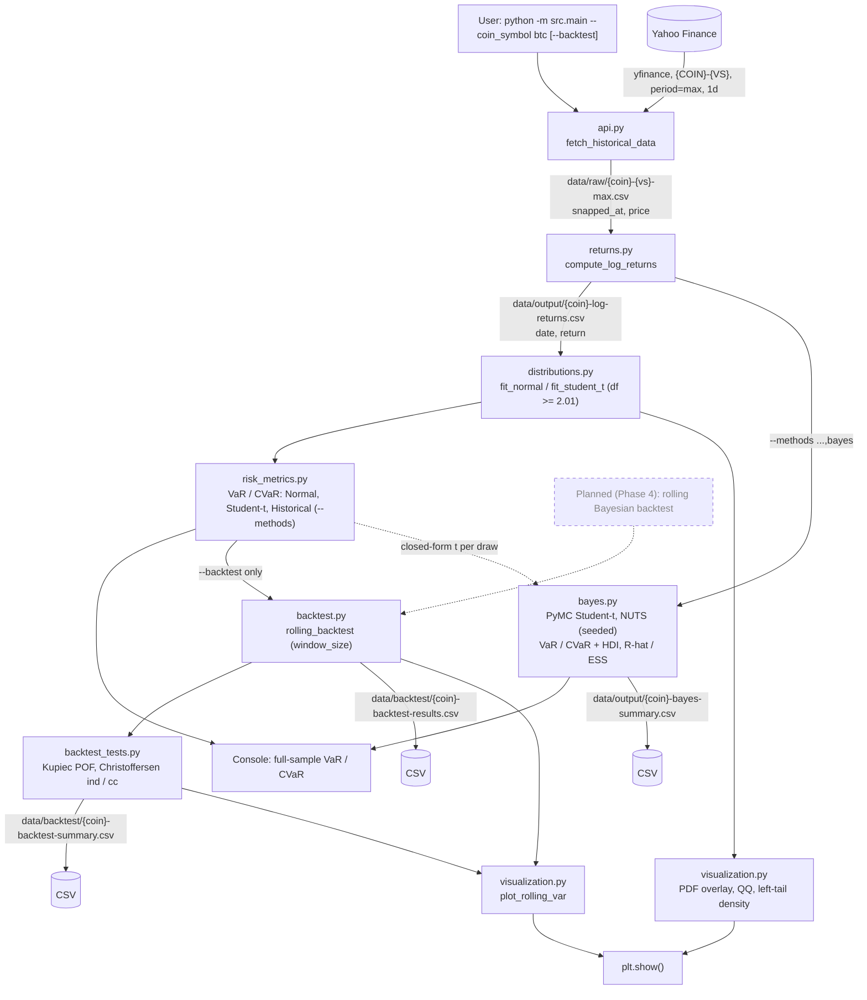

# App Flow: Crypto Risk Engine

> Educational project, not investment advice. Planned steps are marked **Planned**. File layouts are in [SCHEMA.md](SCHEMA.md).

## User flow
1. Install: `python -m venv .venv`, activate, `pip install -r requirements.txt`.
2. Run `python -m src.main --coin_symbol btc` (add `--vs_currency`, `--alpha`, `--backtest`, `--window_size`, `--methods normal,t,hist,bayes` and the Bayes flags `--seed`, `--draws`, `--tune`, `--chains`, `--hdi_prob` as needed).
3. Read the console: return summary stats, then VaR / CVaR at `alpha` for each selected method (default Normal and Student-t). With `bayes`: predictive VaR / CVaR, posterior mean and HDI, the mu / sigma / nu posterior table with R-hat and ESS, any diagnostic warnings, and the sampling time.
4. Inspect the plot windows (PDF overlay, QQ plots, left-tail density; plus rolling VaR with `--backtest`). Closing them ends the run.
5. With `--backtest`, read the printed summary table (breaches, Kupiec / Christoffersen p-values, reject flags) and the CSVs under `data/backtest/`.
6. If working in git, run `git checkout -- data` to restore the committed data files the run overwrote.

## Data flow

## CLI paths

| Command | What runs | Files written |
|---|---|---|
| `python -m src.main --coin_symbol btc` | ETL -> fits -> 3 diagnostic plots -> prints Normal and Student-t VaR / CVaR | `data/raw/btc-usd-max.csv`, `data/output/btc-log-returns.csv` |
| `python -m src.main --coin_symbol btc --backtest [--window_size 252] [--alpha 0.05]` | Above, plus rolling backtest (tqdm progress bar, about 2 min for BTC), summary table, rolling VaR plot | Above, plus `data/backtest/btc-backtest-results.csv`, `data/backtest/btc-backtest-summary.csv` |
| `python -m src.api` / `python -m src.returns` | Single ETL step | raw CSV / returns CSV |
| `python -m src.distributions` / `src.risk_metrics` / `src.visualization` | Read the existing returns CSV; print fits / risk metrics incl. Historical (alpha 0.05) / show plots | none |
| `python -m src.backtest` | Backtest the existing returns CSV and print results | none |
| `python -m pytest` | 37 unit tests on synthetic data (no network; Bayes tests use tiny seeded MCMC, about 10 s total; `-m "not slow"` skips the one slow test) | none |
| `python -m src.main --coin_symbol btc --methods normal,t,hist,bayes [--seed 42] [--draws 1000] [--tune 1000] [--chains 4] [--hdi_prob 0.94]` | Default run, plus Historical metrics and the PyMC Bayesian Student-t (about 5 s extra for BTC) | Default-run files, plus `data/output/btc-bayes-summary.csv` |
| `python -m src.bayes --coin_symbol btc` | Bayes only, on the existing returns CSV; prints results | none |

## Backtest timing (no look-ahead)
For each day `i` from `window_size` to `n-1`: fit on returns `[i-window_size, i)`, forecast VaR/CVaR for day `i`, flag a breach if `return_i < VaR_i`. The first `window_size` days have no forecast, so `total_periods = n - window_size`.
